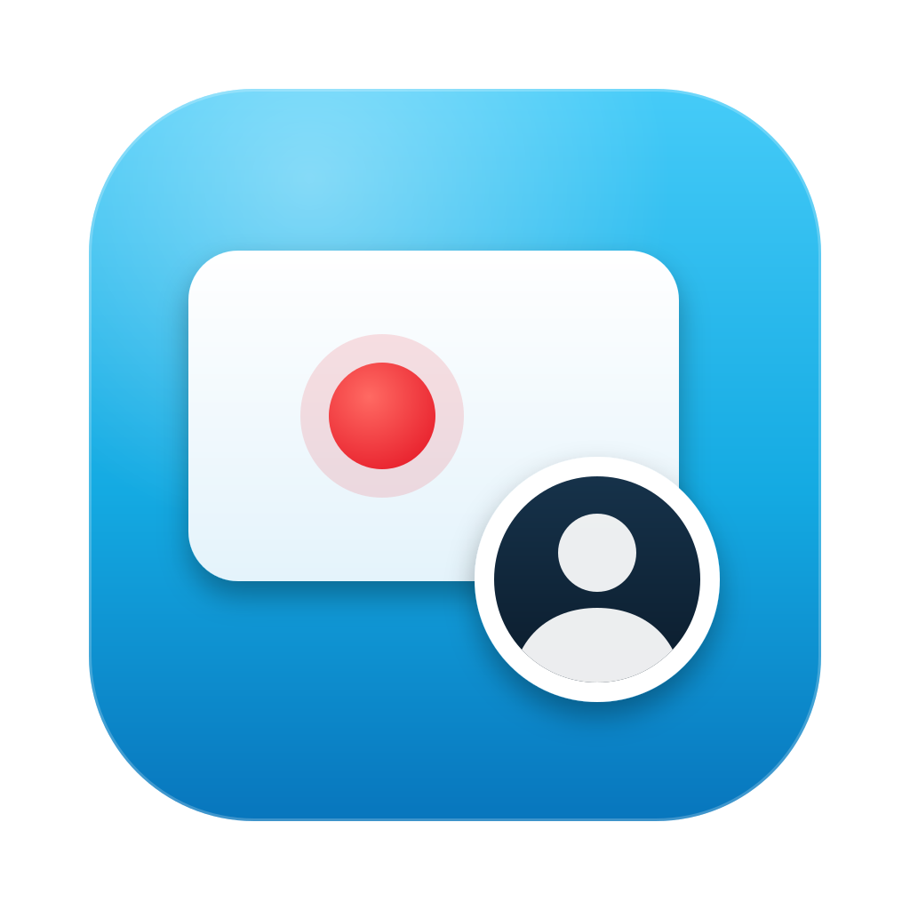

# MyScreen

A free, open-source alternative to Loom for macOS: record your screen with an optional camera bubble, get an MP4 saved locally, and (if you want) a share link uploaded to your own Dropbox. No accounts, no subscriptions, your recordings never touch anyone else's server.



## Download

Grab the latest DMG from [Releases](../../releases/latest), open it, and drag MyScreen to Applications.

The app is signed and notarized, and needs macOS 13 or later on Apple Silicon. On first launch, macOS requires a one-time manual step to allow screen recording (Apple removed the automatic prompt in recent macOS versions); the app walks you through it.

## Features

- **Full screen, window, or camera-only recording** with a live preview
- **Record from the menu bar**: start any kind of recording from the menu bar item or with a global shortcut (⌃⇧R starts or stops, ⌃⇧P pauses). MyScreen hides while it records your full screen and stays in the menu bar when you close its window
- **Camera overlay**: rectangle or circle, in three sizes, mirrored or not. The camera shows on your real screen where it lands in the recording, and you can drag it there
- **Microphone level** next to the microphone setting, so you can see it works before you record
- **Trash or retake** a recording right after you stop, and delete recordings from the overview
- **Pause and resume** (paused time excluded from the recording)
- **Instant save**: recordings land in `~/Movies/MyScreen` (configurable) as MP4 the moment you stop, with no save dialog and no conversion wait. WebM and a smaller-file option are available
- **Share links via your own Dropbox**: connect once, and every saved recording uploads to your Dropbox with a view link copied to your clipboard
- **Crash recovery**: recordings stream to disk while recording; if the app dies mid-take, it offers the recovered video on next launch
- **Agent access**: every recording gets a transcript of your narration and an image of each screen change, so Claude Code and Codex can follow what you showed and said (see below)

## Use recordings with Claude Code and Codex

Record a walkthrough ("watch what happens when I click this, then fix it") and hand it to your coding agent.

1. Leave **Agent access** on (Output section). After each save, MyScreen writes a summary, a timestamped transcript, and key frames to a hidden `.myscreen` folder next to the recording.
2. For a single recording, click **Copy for agent** on the Saved sheet and paste the path into your agent.
3. To let the agent find recordings itself, open **Agent access** and copy the one-line setup command for Claude Code or Codex. It registers MyScreen's bundled MCP server, which can list, read, and search your recordings and return frames for any moment. Then ask, for example, "look at my latest MyScreen recording".

Transcripts are made on your Mac with [whisper.cpp](https://github.com/ggml-org/whisper.cpp), which ships inside the app. The speech model it needs is a one-time 574 MB download that MyScreen offers the first time a transcript is missing (Agent access, or the Saved sheet). Until then you still get the key frames.

## Privacy

Recordings are written to your local disk. Transcripts and key frames are made on your Mac and stay there until an agent you connected reads them. The speech model download is the only time transcription touches the network. The optional share feature uploads to *your* Dropbox account via OAuth (the app folder `Apps/MyScreen Recorder/` is the only thing it can access). There is no telemetry, no backend, no account.

## Development

Vanilla JavaScript, no build step: UI files load directly via script tags (React 18 UMD, vendored). The recording engine is DOM-free and unit-tested with fakes.

```bash
npm install        # also compiles the native screen-permission addon
npm run build:whisper   # optional: builds the transcription engine (needs cmake)
npm start          # run the app
npm test           # unit tests (node:test, no permissions needed)
npm run dist       # build a signed DMG (requires Apple Developer credentials)
```

Architecture notes, testing recipes, and macOS permission gotchas live in [CLAUDE.md](CLAUDE.md) and [docs/TESTING.md](docs/TESTING.md).

## Bundled software

MyScreen ships [FFmpeg](https://ffmpeg.org) (GPL) and [whisper.cpp](https://github.com/ggml-org/whisper.cpp) (MIT). The speech model is OpenAI's Whisper large-v3-turbo (MIT), in the format published by the whisper.cpp project.

## License

[GPL-3.0](LICENSE). Fork it, improve it, ship it. Derivatives must stay open source.
